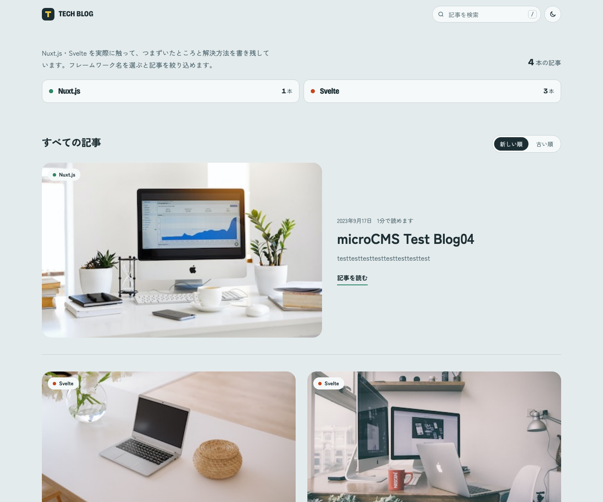
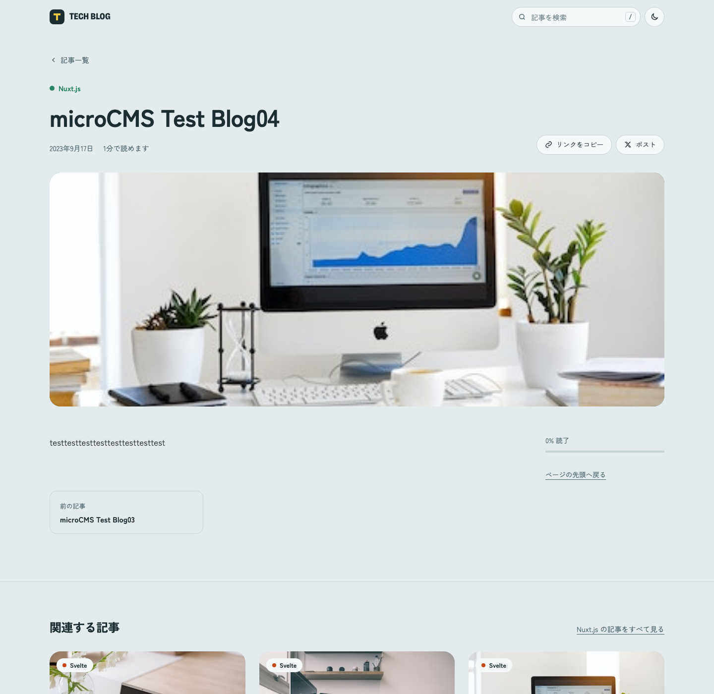
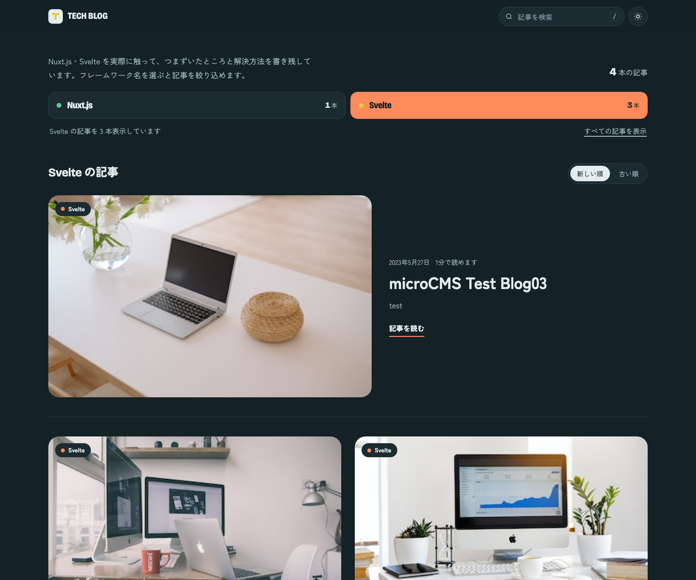
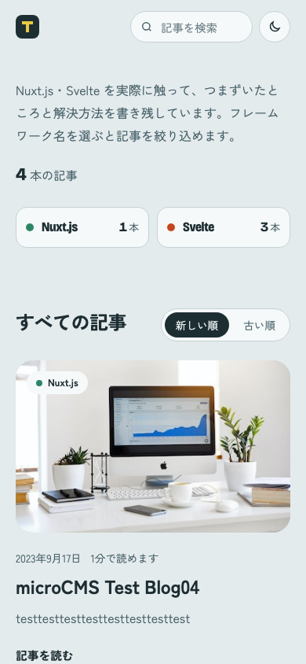

# TECH BLOG — Astro + microCMS

[English](./README.md)

[Astro](https://astro.build/) と [microCMS](https://microcms.io/) で作った技術ブログです。記事はビルド時に microCMS から取得して静的ページとして出力します。記事は Next.js・Nuxt.js・Astro・Gatsby・Svelte などのフレームワーク別に分類しています。



| 記事ページ | ダークモード・カテゴリ絞り込み | スマートフォン |
| :---: | :---: | :---: |
|  |  |  |

## 主な機能

- **カテゴリ絞り込み**：記事のあるフレームワークごとにタイルを表示し、記事数を表示します。クリックで絞り込み、もう一度クリックで解除します。状態は URL（`/?cat=Astro`）に残ります。
- **検索**：入力に合わせてタイトル・概要・カテゴリから絞り込み、一致した部分を強調します。`/` キーで検索欄に移動します。検索状態も URL（`/?q=...`）に残ります。
- **並び替え**：新しい順と古い順を切り替えられます。
- **記事ページ**：読んでいる見出しに追従する目次、読了率バー、コピーボタンと色分け付きのコードブロック、前後の記事、関連記事、リンクのコピーと X へのポスト。
- **ライト／ダークテーマ**：初期状態は OS の設定に合わせます。手動で切り替えた場合はブラウザに保存します。
- **カバー画像の自動生成**：アイキャッチ画像がない記事には、カテゴリ色の幾何学模様を表示します。
- **サンプルデータ**：microCMS の環境変数が未設定のときは、同梱のサンプル記事で表示します。アカウントがなくても動作を確認できます。

## 技術構成

- [Astro](https://astro.build/) 2（静的出力）
- [microCMS](https://microcms.io/)（`microcms-js-sdk`）
- TypeScript、CSS（UI フレームワークなし）

## ディレクトリ構成

```
/
├── docs/screenshots/          # README 用の画面キャプチャ
├── src/
│   ├── layouts/Layout.astro   # ヘッダー・検索・テーマ切替・フッター
│   ├── lib/
│   │   ├── microcms.ts        # microCMS クライアントと getArticles()
│   │   ├── blog.ts            # カテゴリ・日付・カバー画像・本文の整形
│   │   └── sample-articles.ts # 環境変数が未設定のときのサンプル記事
│   ├── pages/
│   │   ├── index.astro        # 記事一覧
│   │   └── articles/[slug].astro
│   ├── styles/global.css
│   └── types/article.ts       # 記事の型定義
└── .env.example
```

## microCMS の設定

**リスト形式の API** を作成し、エンドポイントを `blogs` にして、次のフィールドを用意します。

| フィールド ID | 種類 | 必須 | 備考 |
| :--- | :--- | :---: | :--- |
| `title` | テキストフィールド | ○ | 記事タイトル |
| `content` | リッチエディタ | ○ | 本文 |
| `category` | コンテンツ参照 | ○ | 参照先に `name` フィールドを持つ |
| `eyecatch` | 画像 | | カバー画像。未設定なら自動生成した画像を使用 |
| `excerpt` | テキストエリア | | 一覧に表示する概要。未設定なら本文の冒頭を使用 |

記事の URL は `/articles/{コンテンツID}` です。

カテゴリの `name` を `Next`・`Nuxt`・`Astro`・`Gatsby`・`Svelte` のいずれかにすると、対応する色で表示されます。それ以外の名前でも動作し、その場合は落ち着いたグレー系の色になります。記事が 1 本以上あるカテゴリだけを表示し、紹介文とフッターのカテゴリ名も自動で切り替わります。カテゴリの追加や変更は `src/lib/blog.ts` の `CATEGORIES` で行います。

本文中の `<h2>` は自動で目次に追加され、`<pre><code>` のコードブロックにはコピーボタンが付きます。

## 環境変数

`.env.example` をコピーして `.env` を作成し、値を設定します。

```bash
cp .env.example .env
```

| 変数 | 説明 |
| :--- | :--- |
| `MICROCMS_SERVICE_DOMAIN` | microCMS のサービスドメイン（`xxx.microcms.io` の `xxx`） |
| `MICROCMS_API_KEY` | microCMS の API キー |

どちらかが未設定の場合、ビルド時に警告を出してサンプル記事で表示します。

## コマンド

| コマンド | 内容 |
| :--- | :--- |
| `npm install` | 依存パッケージをインストール |
| `npm run dev` | 開発サーバーを起動（`localhost:4321`） |
| `npm run build` | `./dist/` に本番ビルドを出力 |
| `npm run preview` | ビルド結果をローカルでプレビュー |

## デプロイ

静的サイトとして出力されるため、Vercel・Netlify・Cloudflare Pages などどこにでも置けます。ホスティング先にも同じ環境変数を設定してください。記事はビルド時に取得するので、記事を更新したら再ビルドが必要です。microCMS の Webhook からホスティング先の Deploy Hook を呼ぶと自動化できます。
