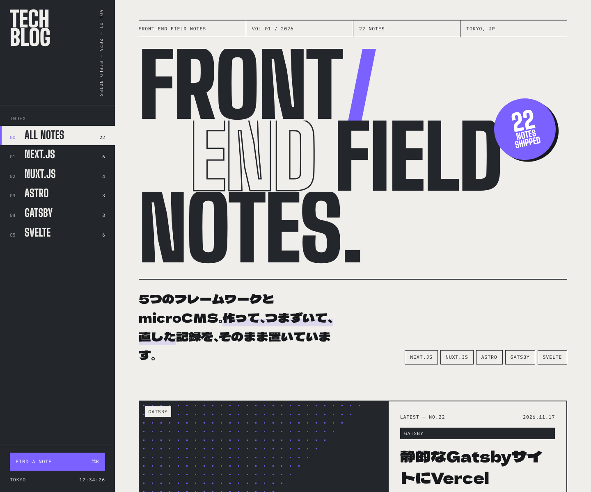
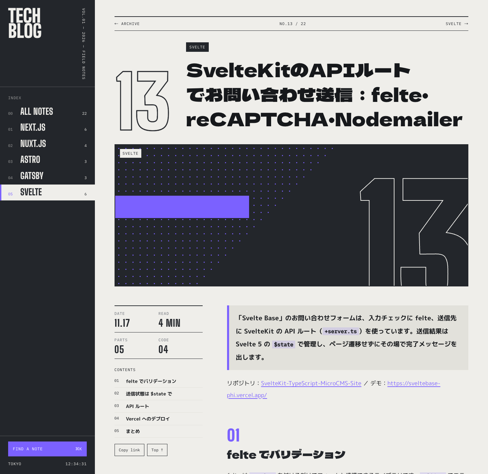
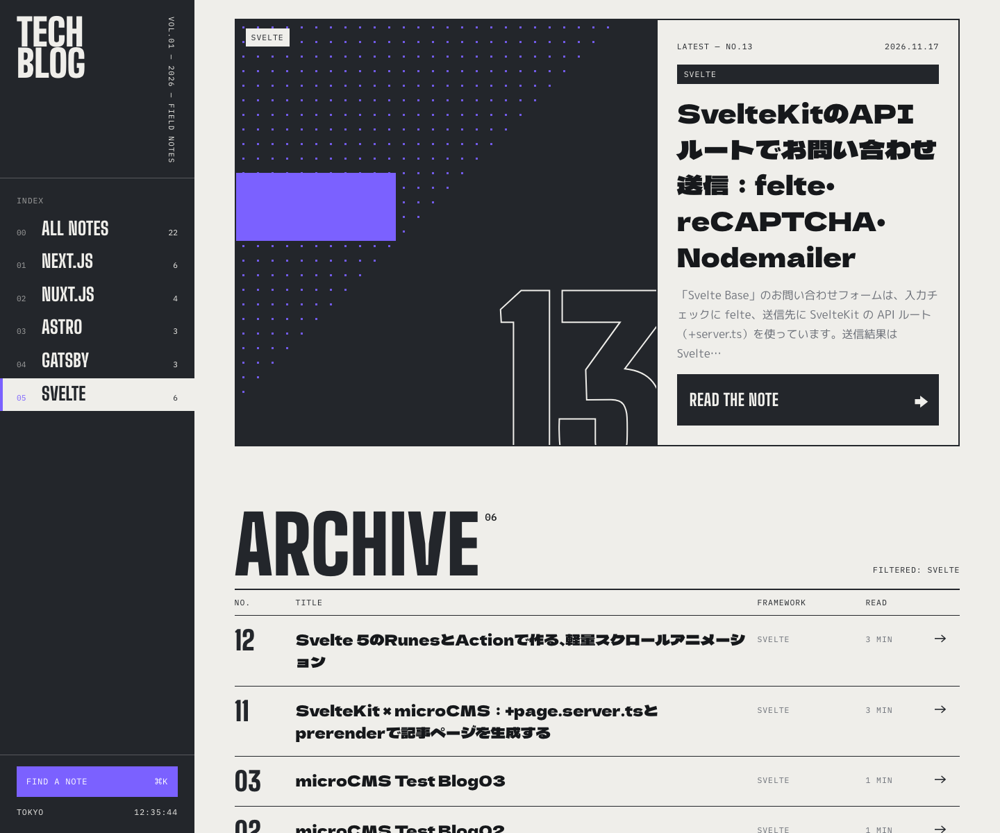
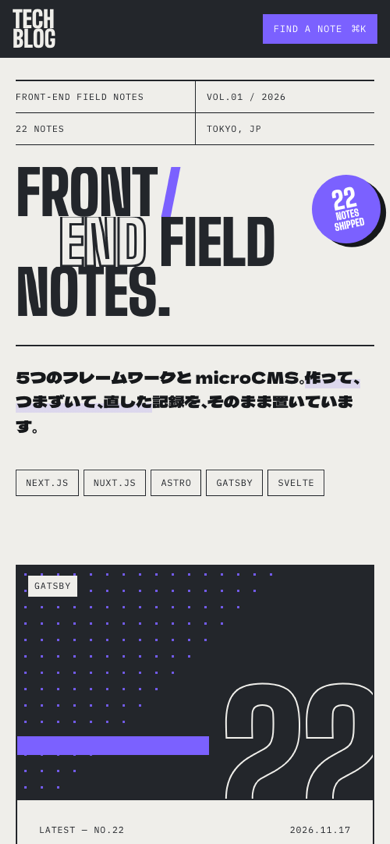

# TECH BLOG — Astro + microCMS

[日本語](./README.ja.md)

A static tech blog built with [Astro](https://astro.build/) and [microCMS](https://microcms.io/). Articles are fetched from microCMS at build time and rendered as static pages. Posts are organized by framework category (for example Next.js, Nuxt.js, Astro, Gatsby, and Svelte).



| Article page | Category filter | Mobile |
| :---: | :---: | :---: |
|  |  |  |

## Features

- **Sidebar index**: one entry per framework that has articles, with its article count. Click one to filter the list. The state is kept in the URL (`/?cat=Astro`).
- **Archive list**: the latest article is shown large and the rest are listed with numbers. Hovering a row opens its summary and cover.
- **⌘K search**: press `⌘K` (`Ctrl K` on Windows) or `/` to open the search dialog. It searches titles, body text, and categories. Use the arrow keys to pick a result and Enter to open it.
- **Article page**: a summary of date, reading time, section count, and code block count; a table of contents that tracks the current heading; a reading progress bar; code blocks with a copy button and syntax colors; previous/next links; and a "copy link" button.
- **Page transitions**: in supporting browsers, View Transitions carry the cover from the list into the article page. Motion is turned off when the reduced-motion setting is on.
- **Generated covers**: articles without an eyecatch image get a cover with the article number and a dot pattern.
- **Sample data fallback**: if the microCMS environment variables are not set, the site uses built-in sample articles, so you can run it without an account.

## Tech stack

- [Astro](https://astro.build/) 2 (static output)
- [microCMS](https://microcms.io/) (`microcms-js-sdk`)
- TypeScript, plain CSS (no UI framework)

## Project structure

```
/
├── docs/screenshots/          # Images used in this README
├── src/
│   ├── components/Cover.astro # Article cover
│   ├── layouts/Layout.astro   # Sidebar, ⌘K search, footer
│   ├── lib/
│   │   ├── microcms.ts        # microCMS client and getArticles()
│   │   ├── blog.ts            # Categories, dates, covers, body processing
│   │   └── sample-articles.ts # Fallback data used when env vars are missing
│   ├── pages/
│   │   ├── index.astro        # Article list
│   │   ├── 404.astro
│   │   └── articles/[slug].astro
│   ├── styles/global.css
│   └── types/article.ts       # Article type
└── .env.example
```

## microCMS setup

Create a **list-type API** with the endpoint `blogs` and these fields:

| Field ID | Type | Required | Notes |
| :--- | :--- | :---: | :--- |
| `title` | Text field | ✓ | Article title |
| `content` | Rich editor | ✓ | Article body |
| `category` | Content reference | ✓ | The referenced API must have a `name` field |
| `eyecatch` | Image | | Cover image. A generated cover is used when empty |
| `excerpt` | Text area | | Summary for the list. When empty, the start of the body is used |

Article URLs are `/articles/{content ID}`.

If a category `name` is `Next.js`, `Nuxt`, `Astro`, `Gatsby`, or `Svelte`, it is listed in that order with a tidied display name. Other names are shown as they are. Only categories with at least one article are shown. You can add or change categories in `CATEGORIES` in `src/lib/blog.ts`.

In the article body, `<h2>` headings are added to the table of contents automatically, and `<pre><code>` blocks get the copy button.

## Environment variables

Copy `.env.example` to `.env` and fill in the values:

```bash
cp .env.example .env
```

| Variable | Description |
| :--- | :--- |
| `MICROCMS_SERVICE_DOMAIN` | Your microCMS service domain (`xxx` in `xxx.microcms.io`) |
| `MICROCMS_API_KEY` | microCMS API key |

If either variable is missing, the build prints a warning and uses the sample articles.

## Commands

| Command | Action |
| :--- | :--- |
| `npm install` | Install dependencies |
| `npm run dev` | Start the dev server at `localhost:4321` |
| `npm run build` | Build the production site to `./dist/` |
| `npm run preview` | Preview the build locally |

## Deployment

The output is a static site, so it can be hosted anywhere (Vercel, Netlify, Cloudflare Pages, etc.). Set the same environment variables on the hosting service. Articles are fetched at build time, so you need to rebuild after editing content. You can automate this by calling your host's deploy hook from a microCMS webhook.
