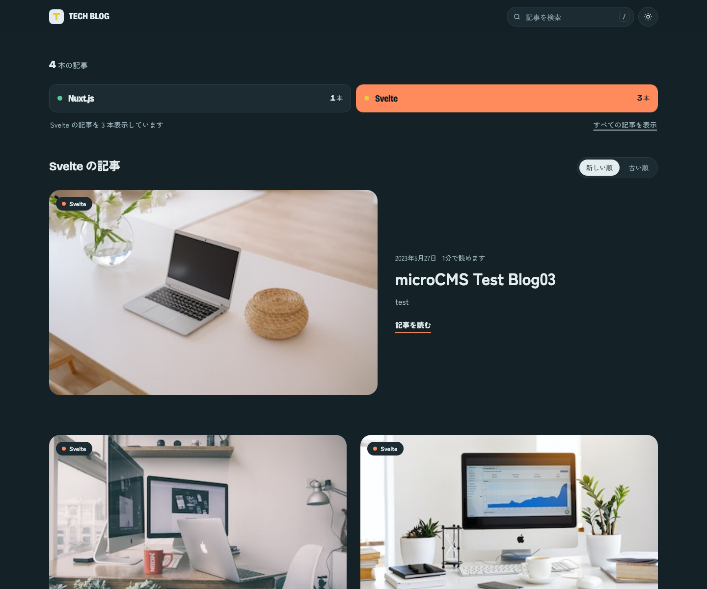

# TECH BLOG — Astro + microCMS

[日本語](./README.ja.md)

A static tech blog built with [Astro](https://astro.build/) and [microCMS](https://microcms.io/). Articles are fetched from microCMS at build time and rendered as static pages. Posts are organized by framework category (for example Next.js, Nuxt.js, Astro, Gatsby, and Svelte).


| Article page | Dark mode / category filter | Mobile |
| :---: | :---: | :---: |
|  |  |  |

## Features

- **Category filter**: one tile per framework that has articles, showing its article count. Click a tile to filter the list and click it again to clear the filter. The state is kept in the URL (`/?cat=Astro`).
- **Search**: filters by title, summary, and category as you type, and highlights matches. Press `/` to focus the search box. The search state is also kept in the URL (`/?q=...`).
- **Sort**: newest first or oldest first.
- **Article page**: table of contents that tracks the current heading, reading progress bar, code blocks with a copy button and syntax colors, previous/next links, related articles, "copy link" and "post to X" buttons.
- **Light and dark themes**: follows the OS setting by default. A manual choice is saved in the browser.
- **Generated cover images**: articles without an eyecatch image get a geometric cover drawn in the category's color.
- **Sample data fallback**: if the microCMS environment variables are not set, the site uses built-in sample articles, so you can run it without an account.

## Tech stack

- [Astro](https://astro.build/) 2 (static output)
- [microCMS](https://microcms.io/) (`microcms-js-sdk`)
- TypeScript, plain CSS (no UI framework)

## Project structure

```
/
├── docs/screenshots/          # Images used in this README
├── src/
│   ├── layouts/Layout.astro   # Header, search, theme toggle, footer
│   ├── lib/
│   │   ├── microcms.ts        # microCMS client and getArticles()
│   │   ├── blog.ts            # Categories, dates, cover images, body processing
│   │   └── sample-articles.ts # Fallback data used when env vars are missing
│   ├── pages/
│   │   ├── index.astro        # Article list
│   │   └── articles/[slug].astro
│   ├── styles/global.css
│   └── types/article.ts       # Article type
└── .env.example
```

## microCMS setup

Create a **list-type API** with the endpoint `blogs` and these fields:

| Field ID | Type | Required | Notes |
| :--- | :--- | :---: | :--- |
| `title` | Text field | ✓ | Article title |
| `content` | Rich editor | ✓ | Article body |
| `category` | Content reference | ✓ | The referenced API must have a `name` field |
| `eyecatch` | Image | | Cover image. A generated cover is used when empty |
| `excerpt` | Text area | | Summary for the list. When empty, the start of the body is used |

Article URLs are `/articles/{content ID}`.

Use one of these category names to get the matching color: `Next`, `Nuxt`, `Astro`, `Gatsby`, `Svelte`. Other names still work and get a neutral color. Only categories with at least one article are shown. You can add or change categories in `CATEGORIES` in `src/lib/blog.ts`.

In the article body, `<h2>` headings are added to the table of contents automatically, and `<pre><code>` blocks get the copy button.

## Environment variables

Copy `.env.example` to `.env` and fill in the values:

```bash
cp .env.example .env
```

| Variable | Description |
| :--- | :--- |
| `MICROCMS_SERVICE_DOMAIN` | Your microCMS service domain (`xxx` in `xxx.microcms.io`) |
| `MICROCMS_API_KEY` | microCMS API key |

If either variable is missing, the build prints a warning and uses the sample articles.

## Commands

| Command | Action |
| :--- | :--- |
| `npm install` | Install dependencies |
| `npm run dev` | Start the dev server at `localhost:4321` |
| `npm run build` | Build the production site to `./dist/` |
| `npm run preview` | Preview the build locally |

## Deployment

The output is a static site, so it can be hosted anywhere (Vercel, Netlify, Cloudflare Pages, etc.). Set the same environment variables on the hosting service. Articles are fetched at build time, so you need to rebuild after editing content. You can automate this by calling your host's deploy hook from a microCMS webhook.
